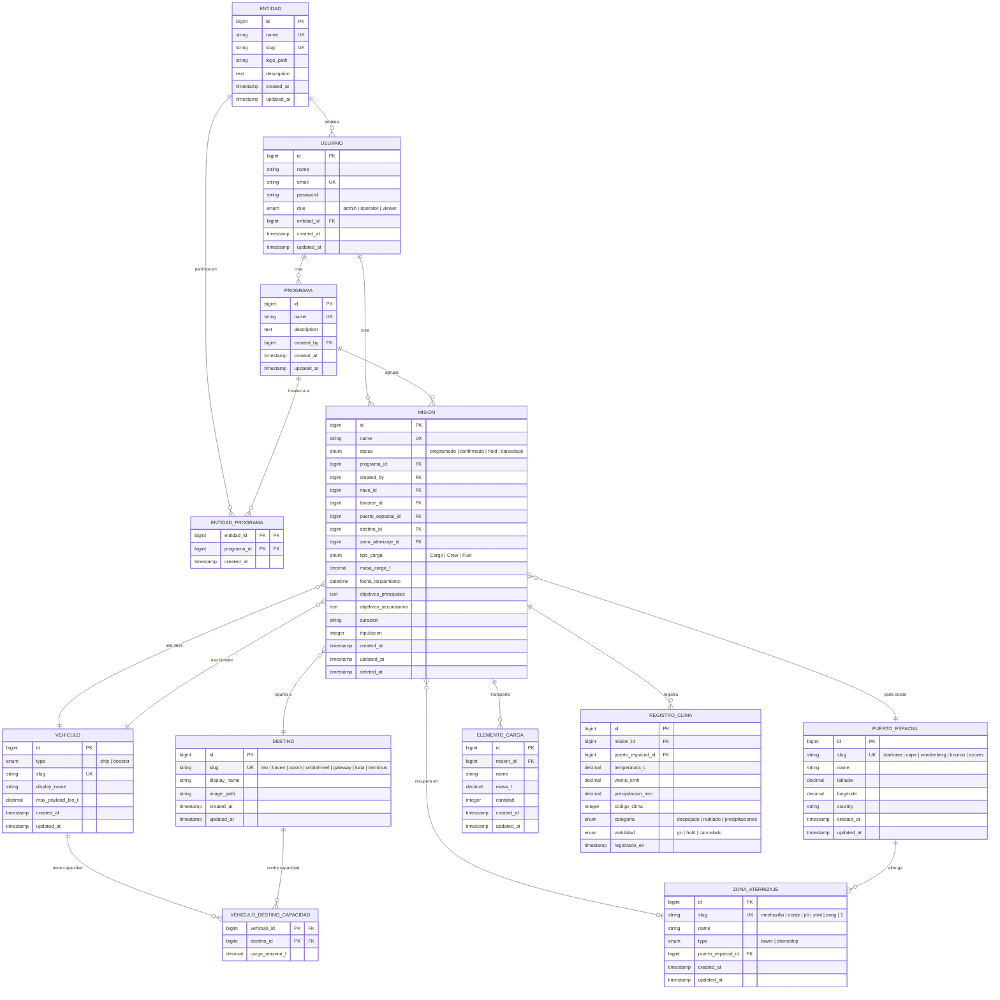

# Starsim — Diagrama Entidad Relación



---

## Explicación

### Entidades

| # | Entidad | Origen en el código | Propósito |
|---|---|---|---|
| 1 | **ENTIDAD** | `header.html` (perfil `Gallardo` asociado implícitamente a una organización) | Representa organizaciones espaciales (SpaceX, NASA, ESA, Blue Origin). Los usuarios pertenecen a una entidad y los programas pueden ser compartidos entre varias entidades. |
| 2 | **USUARIO** | `login.html` (formulario `user`/`pass`) + `header.html` (perfil `Gallardo`) | Representa a los operadores que inician sesión y crean misiones. Pertenece a una entidad. El campo `role` permite segmentación de permisos. |
| 3 | **PROGRAMA** | Campo `program-select` en `mision.html`; atributo `mission.program` en `mision.js:378` | Agrupación lógica de misiones bajo un programa (p.ej. "Artemis II" y "Artemis III" pertenecen al programa "Artemis"). Se normaliza a tabla propia. |
| 4 | **ENTIDAD_PROGRAMA** | Inferida — relación N:N entre entidades y programas | Tabla pivot que vincula entidades con programas. Permite colaboraciones multi-organización (p.ej. NASA + SpaceX + Blue Origin → Artemis). |
| 5 | **PUERTO_ESPACIAL** | `\<select id="port-select">` en `mision.html:93-99`; objeto `mapUrls` en `mision.js:119-125`; `portCities` en `panel.js:467-473` | Almacena las bases de lanzamiento con coordenadas para geocodificación meteorológica. |
| 6 | **VEHICULO** | `\<select id="ship-select">` y `\<select id="booster-select">` en `mision.html:49-61`; mapa `vehicleMap` en `mision.js:53-60` | Tabla unificada para naves (`starship`, `dragon`, `falcon-fairing`) y boosters (`superheavy`, `falcon9`, `falconheavy`). Discriminadas con el campo `type`. |
| 7 | **DESTINO** | `\<select id="destination-select">` en `mision.html:30-38`; mapa `destMap` en `mision.js:62-70` | Destinos orbitales y lunares. Incluye ruta a imagen para representación visual. |
| 8 | **ZONA_ATERRIZAJE** | `\<select id="landing-id-select">` en `mision.html:121-128`; `\<select id="landing-type-select">` en `mision.html:114-117` | Torres de captura y droneships. Vinculada a un puerto espacial ya que cada zona pertenece geográficamente a una base. |
| 9 | **VEHICULO_DESTINO_CAPACIDAD** | Objeto `CAPACITIES` en `mision.js:4-12` | Tabla pivot que reemplaza el mapa hardcodeado de capacidades máximas por combinación vehículo-destino. PK compuesta. |
| 10 | **MISION** | Objetos `missionData` y `launchData` fusionados en `mision.js:282-381`; `MissionService` en `missionService.js` | Entidad central unificada. Una misión **es** un lanzamiento: contiene nombre, estado, programa, configuración de vehículo, carga, puerto, destino, fecha y configuración avanzada. Soporta soft deletes. |
| 11 | **ELEMENTO_CARGA** | Array `cargoItems` en `configAvanzada.js:43`; estructura `{ name, qty, mass }` en `configAvanzada.js:169` | Normaliza los ítems de carga que actualmente se almacenan como JSON en localStorage. |
| 12 | **REGISTRO_CLIMA** | Función `fetchWeather()` en `panel.js:464-593`; datos `current.temperature_2m`, `wind_speed_10m`, `precipitation`, `weather_code` | Almacena snapshots históricos del clima obtenidos de Open-Meteo API para cada misión, incluyendo categorización y viabilidad. |

---

### Relaciones

| Relación | Cardinalidad | Justificación |
|---|---|---|
| `ENTIDAD` → `USUARIO` | **1:N** | Un usuario pertenece a una entidad/organización (p.ej. Gallardo pertenece a SpaceX). |
| `ENTIDAD` ↔ `PROGRAMA` via `ENTIDAD_PROGRAMA` | **N:N** | Un programa puede involucrar a varias entidades y una entidad puede participar en varios programas (p.ej. NASA + SpaceX + Blue Origin → Artemis; SpaceX → Starship; ESA → Ariane). |
| `USUARIO` → `PROGRAMA` | **1:N** | Un usuario puede crear múltiples programas. Derivado de la futura necesidad de autoría. |
| `USUARIO` → `MISION` | **1:N** | Un usuario crea muchas misiones. `MissionService.saveMission()` asigna `createdAt` automáticamente; en backend se asociará al usuario autenticado. |
| `PROGRAMA` → `MISION` | **1:N** | Un programa agrupa muchas misiones (p.ej. Artemis II y Artemis III pertenecen al programa Artemis). La FK `programa_id` es nullable porque el campo program es opcional en el formulario. |
| `MISION` → `VEHICULO` (nave) | **N:1** | Cada misión referencia exactamente una nave. FK `nave_id` apunta a un `VEHICULO` con `type = 'ship'`. |
| `MISION` → `VEHICULO` (booster) | **N:1** | Cada misión referencia exactamente un booster. FK `booster_id` apunta a un `VEHICULO` con `type = 'booster'`. |
| `MISION` → `PUERTO_ESPACIAL` | **N:1** | Cada misión parte de un único puerto. Derivado de `port-select`. |
| `MISION` → `DESTINO` | **N:1** | Cada misión tiene un único destino. Derivado de `destination-select`. |
| `MISION` → `ZONA_ATERRIZAJE` | **N:0..1** | Opcional. Algunas misiones pueden no tener zona de recuperación (p.ej. expendable). |
| `PUERTO_ESPACIAL` → `ZONA_ATERRIZAJE` | **1:N** | Un puerto alberga muchas zonas de aterrizaje (droneships + torres). |
| `MISION` → `ELEMENTO_CARGA` | **1:N** | Una misión transporta múltiples elementos de carga. Derivado de `cargoItems[]` en `configAvanzada.js`. |
| `MISION` → `REGISTRO_CLIMA` | **1:N** | Múltiples consultas meteorológicas por misión (registro histórico). |
| `VEHICULO` ↔ `DESTINO` via `VEHICULO_DESTINO_CAPACIDAD` | **N:N** | Tabla pivot que mapea la carga máxima para cada combinación vehículo-destino. Reemplaza `CAPACITIES` en `mision.js`. |

---

### Suposiciones

| # | Suposición | Justificación |
|---|---|---|
| 1 | **Se infiere la entidad ENTIDAD** para representar organizaciones espaciales. El frontend muestra el nombre `"Gallardo"` como perfil, lo que implica una afiliación organizacional (SpaceX). La entidad permite multi-tenancy y colaboraciones inter-agencia. | `header.html:13` |
| 2 | **Se infiere la entidad USUARIO** a pesar de que el login actual no valida credenciales contra un backend (solo hace `localStorage.setItem('loggedIn', 'true')`). Es necesaria para cualquier sistema de producción. | `login.html:191` |
| 3 | **La relación ENTIDAD ↔ PROGRAMA es N:N** porque programas como Artemis involucran a múltiples agencias (NASA, SpaceX, Blue Origin), mientras que otros (Starship) pertenecen a una sola entidad. La tabla pivot `entidad_programa` resuelve esta relación. | Dominio inferido |
| 4 | **El campo `program` se normaliza a tabla `PROGRAMA`** en lugar de permanecer como string libre, para evitar inconsistencias tipográficas y habilitar filtros consistentes. | `mision.html:26` — actualmente es un `<input type="text">` |
| 5 | **MISION y LANZAMIENTO se fusionan en una única entidad `MISION`** porque en el dominio de StarSim cada misión representa exactamente un evento de lanzamiento. El frontend ya trata ambos conceptos como uno solo: el formulario de `mision.html` crea simultáneamente la misión y su configuración de lanzamiento. | `mision.js:377-381` |
| 6 | **VEHICULO es una tabla unificada** con columna `type` discriminadora (`ship`/`booster`) en lugar de dos tablas separadas, ya que el frontend usa los mismos slugs internos en ambos selects y un vehículo comparte atributos comunes. | `mision.html:49-61`, `mision.js:53-60` |
| 7 | **`zona_aterrizaje_id` es nullable** en MISION porque no toda misión requiere recuperación del booster. El ID `"1"` en el select se interpreta como un identificador genérico para pads sin nombre explícito. | `mision.html:122` |
| 8 | **`duracion` se almacena como string** (formato `MM/DD/HH/mm`) en lugar de integer, respetando el patrón del input con regex de formato. En backend podría transformarse a minutos totales, pero se preserva la fidelidad al frontend. | `configAvanzada.html:15-16` |
| 9 | **Las categorías de clima se reducen a tres** (`despejado`, `nublado`, `precipitaciones`) según la lógica real de `fetchWeather()`, eliminando `tormenta` que no se implementa en el código actual. | `panel.js:527-546` |
| 10 | **SoftDeletes se aplican a MISION** para permitir recuperación de datos eliminados accidentalmente, replicando el patrón de `deleteMission()` de forma segura. | `missionService.js:110-121` |
| 11 | **`masa_carga_t` en MISION es un campo cacheado** que se calcula sumando `elementos_carga`. Puede mantenerse por performance o calcularse dinámicamente con un accessor Eloquent. | `mision.js:21-33` |

---

## Mapeo a Laravel

### Modelos

| Modelo Eloquent | Tabla MySQL | Archivo fuente principal |
|---|---|---|
| `Entidad` | `entidades` | `header.html` (inferido) |
| `Usuario` | `usuarios` | `login.html`, `header.html` |
| `Programa` | `programas` | `mision.js:378-379` |
| `PuertoEspacial` | `puertos_espaciales` | `mision.js:119-125`, `panel.js:467-473` |
| `Vehiculo` | `vehiculos` | `mision.js:53-60`, `mision.html:49-61` |
| `Destino` | `destinos` | `mision.js:62-70`, `mision.html:30-38` |
| `ZonaAterrizaje` | `zonas_aterrizaje` | `mision.html:114-128` |
| `Mision` | `misiones` | `missionService.js`, `mision.js:282-381` |
| `ElementoCarga` | `elementos_carga` | `configAvanzada.js:43-169` |
| `RegistroClima` | `registros_clima` | `panel.js:464-593` |

---

### Relaciones (Eloquent)

```php
// Entidad
class Entidad extends Model {
    public function usuarios(): HasMany { return $this->hasMany(Usuario::class, 'entidad_id'); }
    public function programas(): BelongsToMany {
        return $this->belongsToMany(Programa::class, 'entidad_programa')
                    ->withPivot('created_at');
    }
}

// Usuario
class Usuario extends Authenticatable {
    public function entidad(): BelongsTo  { return $this->belongsTo(Entidad::class, 'entidad_id'); }
    public function programas(): HasMany  { return $this->hasMany(Programa::class, 'created_by'); }
    public function misiones(): HasMany   { return $this->hasMany(Mision::class, 'created_by'); }
}

// Programa
class Programa extends Model {
    public function creador(): BelongsTo    { return $this->belongsTo(Usuario::class, 'created_by'); }
    public function entidades(): BelongsToMany {
        return $this->belongsToMany(Entidad::class, 'entidad_programa')
                    ->withPivot('created_at');
    }
    public function misiones(): HasMany     { return $this->hasMany(Mision::class, 'programa_id'); }
}

// PuertoEspacial
class PuertoEspacial extends Model {
    public function zonasAterrizaje(): HasMany { return $this->hasMany(ZonaAterrizaje::class, 'puerto_espacial_id'); }
    public function misiones(): HasMany        { return $this->hasMany(Mision::class, 'puerto_espacial_id'); }
}

// Vehiculo
class Vehiculo extends Model {
    public function misionesComoNave(): HasMany    { return $this->hasMany(Mision::class, 'nave_id'); }
    public function misionesComoBooster(): HasMany { return $this->hasMany(Mision::class, 'booster_id'); }
    public function destinos(): BelongsToMany {
        return $this->belongsToMany(Destino::class, 'vehiculo_destino_capacidades')
                    ->withPivot('carga_maxima_t');
    }
}

// Destino
class Destino extends Model {
    public function misiones(): HasMany { return $this->hasMany(Mision::class, 'destino_id'); }
    public function vehiculos(): BelongsToMany {
        return $this->belongsToMany(Vehiculo::class, 'vehiculo_destino_capacidades')
                    ->withPivot('carga_maxima_t');
    }
}

// ZonaAterrizaje
class ZonaAterrizaje extends Model {
    public function puertoEspacial(): BelongsTo { return $this->belongsTo(PuertoEspacial::class, 'puerto_espacial_id'); }
    public function misiones(): HasMany         { return $this->hasMany(Mision::class, 'zona_aterrizaje_id'); }
}

// Mision
class Mision extends Model {
    use SoftDeletes;
    public function creador(): BelongsTo        { return $this->belongsTo(Usuario::class, 'created_by'); }
    public function programa(): BelongsTo       { return $this->belongsTo(Programa::class, 'programa_id'); }
    public function nave(): BelongsTo           { return $this->belongsTo(Vehiculo::class, 'nave_id'); }
    public function booster(): BelongsTo        { return $this->belongsTo(Vehiculo::class, 'booster_id'); }
    public function puertoEspacial(): BelongsTo { return $this->belongsTo(PuertoEspacial::class, 'puerto_espacial_id'); }
    public function destino(): BelongsTo        { return $this->belongsTo(Destino::class, 'destino_id'); }
    public function zonaAterrizaje(): BelongsTo { return $this->belongsTo(ZonaAterrizaje::class, 'zona_aterrizaje_id'); }
    public function elementosCarga(): HasMany   { return $this->hasMany(ElementoCarga::class, 'mision_id'); }
    public function registrosClima(): HasMany   { return $this->hasMany(RegistroClima::class, 'mision_id'); }

    // Accessor para masa total calculada
    public function getMasaCargaTAttribute(): float {
        return $this->elementosCarga->sum(fn($e) => $e->masa_t * $e->cantidad);
    }
}

// ElementoCarga
class ElementoCarga extends Model {
    public function mision(): BelongsTo { return $this->belongsTo(Mision::class, 'mision_id'); }
}

// RegistroClima
class RegistroClima extends Model {
    public $timestamps = false;
    public function mision(): BelongsTo         { return $this->belongsTo(Mision::class, 'mision_id'); }
    public function puertoEspacial(): BelongsTo { return $this->belongsTo(PuertoEspacial::class, 'puerto_espacial_id'); }
}
```

---

### Notas de Migración

#### Orden de ejecución (resuelve dependencias de FK)

```
1. entidades
2. usuarios             → FK: entidad_id → entidades.id
3. programas            → FK: created_by → usuarios.id
4. entidad_programa     → FK compuesta: entidad_id, programa_id
5. puertos_espaciales
6. vehiculos
7. destinos
8. vehiculo_destino_capacidades → FK compuesta: vehiculo_id, destino_id
9. zonas_aterrizaje     → FK: puerto_espacial_id → puertos_espaciales.id
10. misiones            → FK: programa_id, created_by, nave_id, booster_id, puerto_espacial_id, destino_id, zona_aterrizaje_id
11. elementos_carga     → FK: mision_id → misiones.id
12. registros_clima     → FK: mision_id, puerto_espacial_id
```

#### Restricciones y campos clave

| Tabla | Campo | Restricción | Notas |
|---|---|---|---|
| `entidades` | `name` | `unique`, `not null` | Nombre de la organización |
| `entidades` | `slug` | `unique` | Lookup rápido (p.ej. `spacex`, `nasa`, `esa`) |
| `entidades` | `logo_path` | `nullable` | Path al logotipo de la organización |
| `usuarios` | `email` | `unique`, `not null` | Índice para login |
| `usuarios` | `password` | `not null` | Bcrypt hash (60 chars) |
| `usuarios` | `role` | `enum`, default `'operator'` | PHP-backed enum en Laravel 11 |
| `usuarios` | `entidad_id` | `foreign`, `constrained` | `onDelete('cascade')` — todo usuario pertenece a una entidad |
| `entidad_programa` | `(entidad_id, programa_id)` | `primary` (compuesta) | No `id` autoincrement |
| `entidad_programa` | `created_at` | `timestamp` | Cuándo se asignó la entidad al programa |
| `programas` | `name` | `unique` | Evitar duplicados tipográficos |
| `programas` | `description` | `nullable` | Texto largo opcional |
| `programas` | `created_by` | `foreign`, `constrained` | `onDelete('cascade')` |
| `puertos_espaciales` | `slug` | `unique`, `index` | Lookup rápido |
| `puertos_espaciales` | `latitude` | `decimal(10,7)` | Precisión para geocoding |
| `puertos_espaciales` | `longitude` | `decimal(10,7)` | Precisión para geocoding |
| `vehiculos` | `slug` | `unique` | Lookup rápido |
| `vehiculos` | `max_payload_leo_t` | `decimal(8,2)`, `nullable` | Solo boosters; naves = null |
| `destinos` | `slug` | `unique` | Lookup rápido |
| `destinos` | `image_path` | `nullable` | Path relativo al asset en frontend |
| `zonas_aterrizaje` | `slug` | `unique` | Lookup rápido |
| `zonas_aterrizaje` | `puerto_espacial_id` | `foreign`, `constrained` | `onDelete('cascade')` |
| `vehiculo_destino_capacidades` | `(vehiculo_id, destino_id)` | `primary` (compuesta) | No `id` autoincrement |
| `vehiculo_destino_capacidades` | `carga_maxima_t` | `decimal(8,2)`, `not null` | Toneladas métricas |
| `misiones` | `name` | `unique` | Validado en `saveMission()` — check de duplicados case-insensitive |
| `misiones` | `status` | `enum`, default `'programado'` | Valores: programado, confirmado, hold, cancelado |
| `misiones` | `programa_id` | `foreign`, `nullable`, `constrained` | `onDelete('set null')` — una misión puede no tener programa |
| `misiones` | `created_by` | `foreign`, `constrained` | `onDelete('cascade')` |
| `misiones` | `nave_id` | `foreign`, `constrained` | Referencia `vehiculos` con `type = 'ship'` |
| `misiones` | `booster_id` | `foreign`, `constrained` | Referencia `vehiculos` con `type = 'booster'` |
| `misiones` | `puerto_espacial_id` | `foreign`, `constrained` | Puerto de lanzamiento |
| `misiones` | `destino_id` | `foreign`, `constrained` | Destino orbital/lunar |
| `misiones` | `zona_aterrizaje_id` | `foreign`, `nullable`, `constrained` | `onDelete('set null')` |
| `misiones` | `tipo_carga` | `enum` | Cargo, Crew, Fuel |
| `misiones` | `masa_carga_t` | `decimal(8,2)`, `nullable` | Cache calculado o accessor |
| `misiones` | `fecha_lanzamiento` | `datetime`, `not null` | Validado como required en frontend |
| `misiones` | `duracion` | `string(20)`, `nullable` | Formato `MM/DD/HH/mm` |
| `misiones` | `tripulacion` | `integer`, `unsigned`, `nullable` | Default 0 en frontend |
| `misiones` | `deleted_at` | `softDeletes` | Recuperación de misiones eliminadas |
| `elementos_carga` | `mision_id` | `foreign`, `constrained` | `onDelete('cascade')` |
| `elementos_carga` | `masa_t` | `decimal(8,3)` | Precisión de 3 decimales (kg resolution) |
| `elementos_carga` | `cantidad` | `integer`, `unsigned`, default `1` | Min: 1 |
| `registros_clima` | `mision_id` | `foreign`, `constrained` | `onDelete('cascade')` |
| `registros_clima` | `puerto_espacial_id` | `foreign`, `constrained` | Puerto donde se tomó la lectura |
| `registros_clima` | `codigo_clima` | `integer` | Código WMO de Open-Meteo (0-99) |
| `registros_clima` | `categoria` | `enum` | despejado (code 0), nublado (1-48), precipitaciones (51+) |
| `registros_clima` | `viabilidad` | `enum` | go, hold, cancelado — derivada de categoría |
| `registros_clima` | `registrado_en` | `timestamp` | Momento de la consulta API |

---

#### Índices recomendados

```sql
-- Consultas frecuentes en panel y programa
CREATE INDEX idx_usuarios_entidad ON usuarios(entidad_id);
CREATE INDEX idx_misiones_status ON misiones(status);
CREATE INDEX idx_misiones_created_by ON misiones(created_by);
CREATE INDEX idx_misiones_programa ON misiones(programa_id);
CREATE INDEX idx_misiones_fecha ON misiones(fecha_lanzamiento);
CREATE INDEX idx_elementos_carga_mision ON elementos_carga(mision_id);
CREATE INDEX idx_registros_clima_mision ON registros_clima(mision_id);
```

---

#### Autenticación

- Usar **Laravel Sanctum** para autenticación SPA por cookie/token, ya que el frontend es una SPA en JavaScript puro con hash routing.
- Proteger todas las rutas API con middleware `auth:sanctum`.

#### API Resources

- Implementar clases `JsonResource` para serializar modelos; el frontend actualmente espera JSON plano que coincida con el esquema de `localStorage`. La capa de recursos actúa como puente de compatibilidad.

#### Seeders

Poblar catálogos estáticos derivados de los `<select>` del frontend:

| Seeder | Datos | Origen |
|---|---|---|
| `EntidadSeeder` | Registros iniciales (SpaceX, NASA, ESA, Blue Origin, etc.) | Dominio inferido |
| `PuertoEspacialSeeder` | 5 registros (starbase, cape, vandenberg, kourou, azores) | `mision.html:93-98` |
| `VehiculoSeeder` | 6 registros (3 naves + 3 boosters) | `mision.html:49-61` |
| `DestinoSeeder` | 7 registros (leo, haven, axiom, orbital-reef, gateway, luna, terminus) | `mision.html:31-37` |
| `ZonaAterrizajeSeeder` | 6 registros (1, mechazilla, ytml, ocisly, jrti, asog) | `mision.html:122-127` |
| `VehiculoDestinoCapacidadSeeder` | ~15 registros (combinaciones del mapa CAPACITIES) | `mision.js:4-12` |
